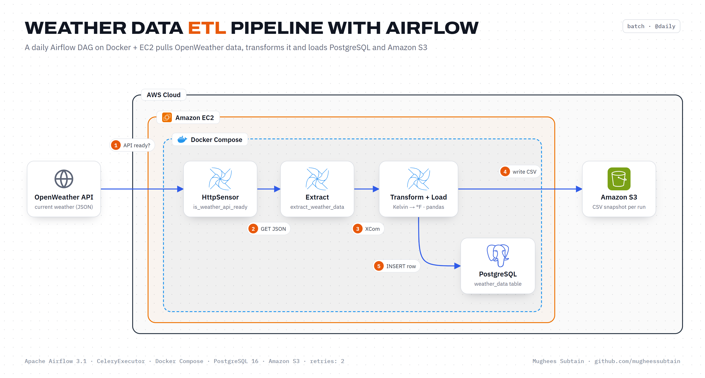

<div align="center">

# Weather Data ETL Pipeline with Airflow

**A daily Apache Airflow DAG, running in Docker on Amazon EC2, that extracts live weather from the OpenWeather API, transforms it and loads it into PostgreSQL and Amazon S3.**


</div>



## Overview

Weather data changes constantly, and analysts want it in two places: a relational table for queries and a file archive for history. This project automates both with a single orchestrated workflow:

- An **HttpSensor** checks that the OpenWeather API is reachable before any work starts.
- A **Python task** calls the API for the current weather in Portland and passes the JSON downstream via XCom.
- A **transform task** flattens the response, converts temperatures from Kelvin to Fahrenheit and shifts timestamps to local time.
- The same task **loads** one row into **PostgreSQL** and writes a timestamped **CSV snapshot to Amazon S3**.
- **Airflow** schedules the DAG daily and retries failed tasks twice, two minutes apart.

## How it works

| Step | What happens | Component |
|:---:|---|---|
| 1 | Poke the API endpoint until it responds | `is_weather_api_ready` (HttpSensor) |
| 2 | Fetch current weather as JSON | `extract_weather_data` (PythonOperator + HttpHook) |
| 3 | Pass the payload to the next task | Airflow XCom |
| 4 | Write `current_weather_data_portland_<timestamp>.csv` | Amazon S3 via `pandas` + `s3fs` |
| 5 | Insert the transformed record into `weather_data` | PostgreSQL via `PostgresHook` |

## Tech stack

| Layer | Technology |
|---|---|
| Orchestration | Apache Airflow 3.1 (CeleryExecutor, Redis broker) |
| Runtime | Docker Compose on Amazon EC2 |
| Extract | OpenWeather Current Weather API, `HttpSensor`, `HttpHook` |
| Transform | Python, `pandas` |
| Load | PostgreSQL 16 (`PostgresHook`), Amazon S3 (`s3fs`) |
| Admin | pgAdmin 4, Flower (optional) |

## Project structure

```
.
├── docker_exp/
│   ├── dags/
│   │   └── weather_dag.py      # the ETL DAG
│   ├── docker-compose.yaml     # Airflow, Redis, PostgreSQL, pgAdmin
│   ├── Dockerfile              # Airflow image with s3fs and boto3
│   └── .env.example
├── docs/
│   ├── architecture.png        # architecture diagram
│   └── setup-guide.md          # EC2, Docker and Airflow setup
├── sql/
│   └── create_weather_table.sql
└── requirements.txt
```

## Getting started

### Prerequisites

- An AWS account with an EC2 instance (`t2.xlarge` recommended) and an S3 bucket
- An OpenWeather API key
- Docker and Docker Compose on the instance

### 1. Deploy the stack

Follow [docs/setup-guide.md](docs/setup-guide.md) to launch EC2, install Docker and copy the project, then:

```bash
cd docker_exp
cp .env.example .env          # set your bucket; AWS keys are optional with an IAM role
docker-compose up -d --build
```

### 2. Create the table

Run [sql/create_weather_table.sql](sql/create_weather_table.sql) in pgAdmin (http://localhost:5050) against the `airflow` database.

### 3. Configure Airflow

In the Airflow UI (http://localhost:8080):

- **Variable** `openweather_api_key` = your API key
- **Connection** `weathermap_api` (HTTP, host `https://api.openweathermap.org`)
- **Connection** `postgres_default` (Postgres, host `postgres`, database `airflow`)

### 4. Run

Unpause and trigger `weather_dag`. Check the new row in `weather_data` and the new CSV in your bucket.

## Outcome

- The full extract, transform and dual load runs unattended on a daily schedule, with automatic retries.
- Containerising Airflow and moving the steps into a single DAG reduced pipeline overhead by about 50% compared with running the scripts by hand.

## Possible improvements

- Fetch several cities per run with dynamic task mapping.
- Write Parquet partitioned by date and query it with Athena.
- Split transform and load into separate tasks so each destination can retry independently.

## Author

**Mughees Subtain**, Data Engineer
[GitHub](https://github.com/mugheessubtain) · [LinkedIn](https://www.linkedin.com/in/mughees-subtain-17aab72ba/)
